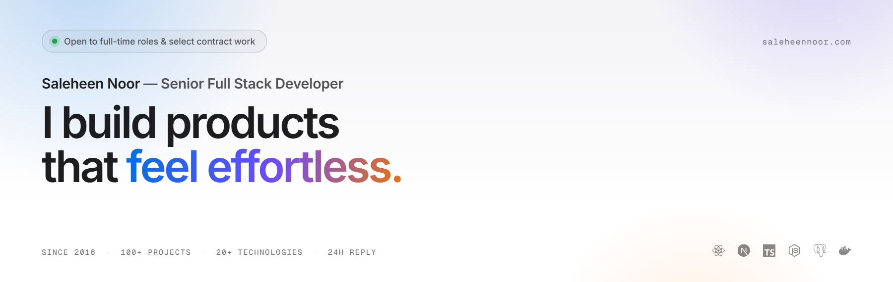

<picture>
  <source media="(prefers-color-scheme: dark)" srcset="./assets/banner-dark.png">
  
</picture>

  
  
  
  
  

## 01 — The short version

I'm a senior full-stack developer in Karachi, and since 2016 I've been turning product ideas into software people actually use — React and Next.js on the front, Node and Postgres behind it, React Native when it belongs in someone's pocket.

For the last four years I've been building and running a live food-delivery marketplace in Germany: the Android and iOS apps, the real-time terminal the restaurants run their day on, the servers underneath, and the release pipeline that carries every update to the stores.

More recently most of my work has moved toward AI that can be audited — retrieval over your own documents, answers that cite their sources, and agents that would rather say "I don't know" than invent an answer.

## 02 — What I'm focused on

- **Shipping [Queryme](https://queryme.saleheen.dev/)** — an answer engine that turns scattered documentation into a cited assistant, delivered as a site widget, a REST API, an MCP server and a support form.
- **Maintaining [Dtask](https://github.com/saleheen-dev/Dtask)** — an MIT-licensed desktop app that finds whatever is holding a port and frees it, on Windows, macOS and Linux.
- **Treating evaluation as the product** — measuring whether a RAG answer is right, not just whether it sounds right.
- **Open to** senior full-stack or product-engineering roles, remote and worldwide, plus a small number of contract builds.

## 03 — Selected work

  
  

  
  

- **[Queryme](https://www.saleheennoor.com/work/queryme)** — answers with sources, not hallucinations: 10+ connectors, retrieval over pgvector, and the same knowledge base delivered as a widget, an API, an MCP server and a support form. `Next.js` `TypeScript` `RAG` `pgvector`
- **[Dtask](https://github.com/saleheen-dev/Dtask)** — an MIT-licensed port manager for Windows, macOS and Linux: `contextIsolation` on, a deliberately small IPC surface, and a release pipeline anyone can fork and build. `Electron` `React 19` `TypeScript`
- **[Nova](https://www.saleheennoor.com/work/nova)** — NFT lending, leasing and minting with no custodian in the middle, executed end to end by four auditable ink! contracts on Polkadot. `Polkadot` `ink!` `WebSockets`
- **[Liefermars](https://www.saleheennoor.com/work/liefermars)** — a multi-vendor marketplace's Android and iOS apps, built from scratch and maintained through live store releases since 2022. `React Native` `REST` `AWS`

Seven more projects live at [saleheennoor.com/#work](https://www.saleheennoor.com/#work).

## 04 — How I build

**Make the model show its working.** Generating an answer is the easy half; making it checkable is the product. In Queryme every sentence links to the document behind it, and "that isn't in your docs" is a first-class result rather than a failure state.

**Design the failure state before the happy path.** If a dependency drops, software should say so and stay useful. When Nova's chain node is unreachable the wallet still connects, balances stay readable, and only what genuinely needs the chain is disabled — with a reason next to it.

**The release path is part of the product.** Servers, pipelines, store submissions, rollbacks. A feature isn't finished when the pull request merges; it's finished when it is live and the next release is uneventful.

## 05 — The toolbox

| Layer | What I reach for |
|:--|:--|
| **Frontend** | React · Next.js · TypeScript · React Native · Expo · Tailwind · TanStack Query · Redux |
| **Backend** | Node.js · Express · tRPC · Hono · PostgreSQL · Prisma · MongoDB · Redis · GraphQL |
| **AI** | LLM APIs · RAG pipelines · pgvector · MCP servers · prompt engineering |
| **Payments** | Stripe · PayPal · Mollie · Lemon Squeezy |
| **Ship** | Docker · AWS · Vercel · GitHub Actions · Jenkins · Nginx · Linux |

## 06 — Elsewhere

- **Portfolio** — [saleheennoor.com](https://www.saleheennoor.com) for the full case studies, capabilities and a contact form.
- **Writing** — [saleheennoor.com/blog](https://www.saleheennoor.com/blog); the latest is *How I automated multi-server startup in my monorepo*.
- **Résumé** — [saleheennoor.com/resume](https://www.saleheennoor.com/resume), also available as a PDF.
- **Email** — [developer.saleheen@gmail.com](mailto:developer.saleheen@gmail.com).

Karachi, Pakistan · working with teams worldwide · replying within a day

